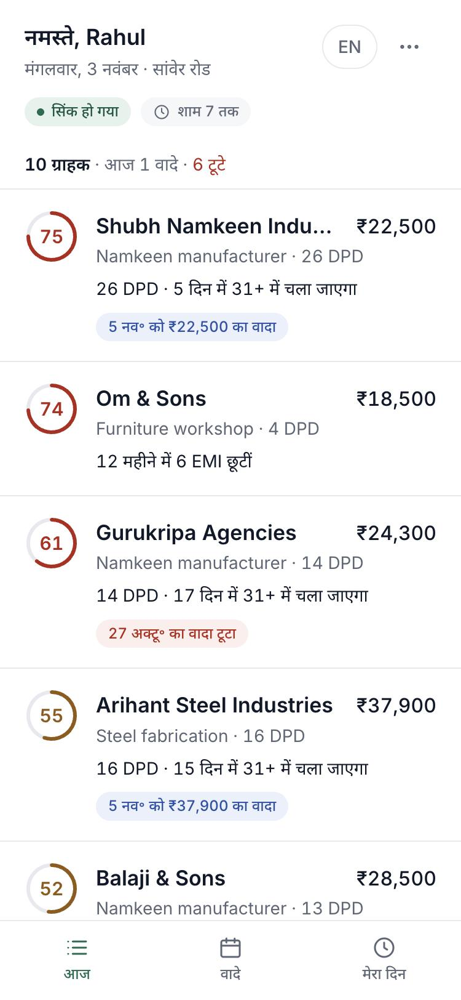
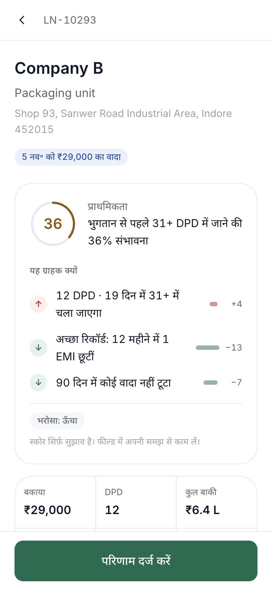
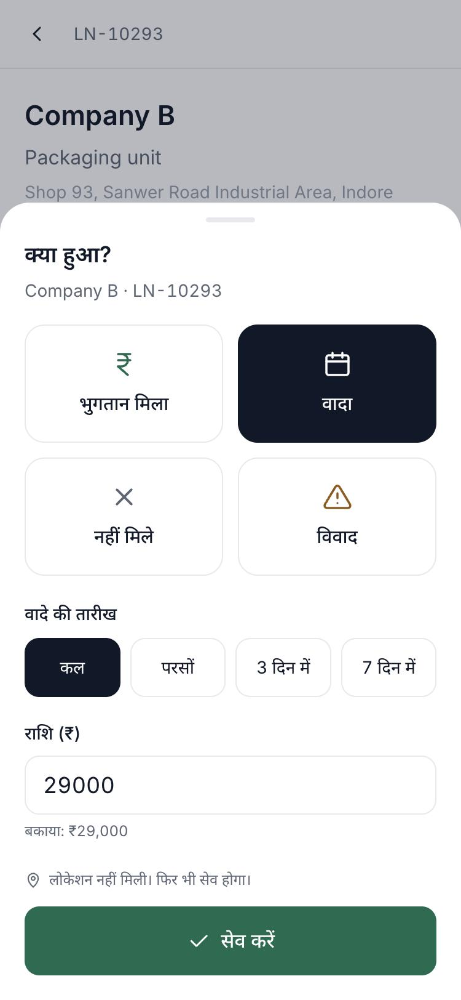
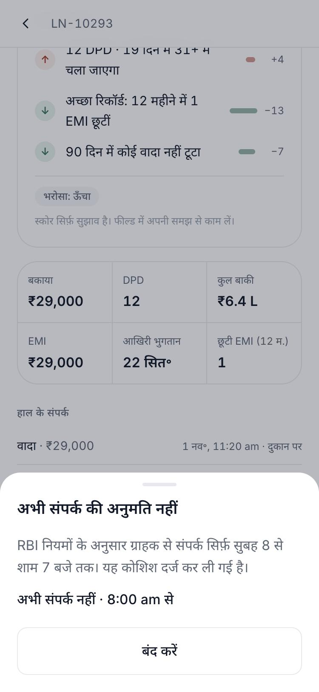
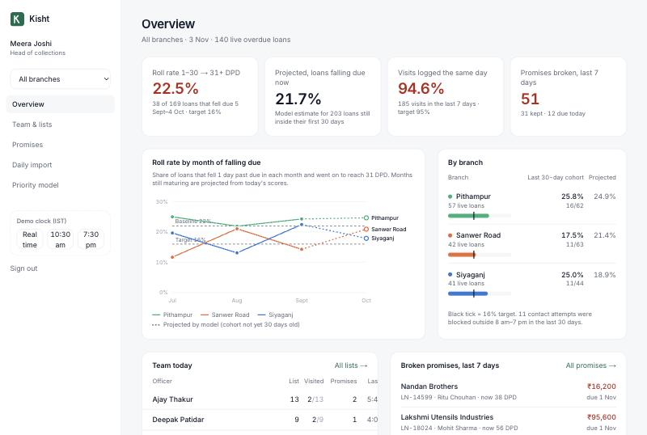

# Kisht: field collections for an NBFC

Every morning the loan system's overdue list becomes a **prioritised, explained list on each field officer's phone**: in Hindi, working offline, with an outcome logged in **three taps**. Borrower contact is **blocked outside 8 am–7 pm** (RBI) and every attempt is recorded. Promises to pay are tracked and reminded, and managers see **roll rates by branch the same day**, not in Friday's Excel.

**Live demo:** https://kisht-alpha.vercel.app · password `kisht-demo-2026` for every account (one-tap sign-in on the login page)
**Design document:** [docs/TDD.pdf](docs/TDD.pdf) · **Run, deploy, logins:** [deployment.md](deployment.md)

| Try it as | Email | You'll see |
|---|---|---|
| Field officer (use a phone-sized window) | `rahul@kisht.demo` | Company B: 12 DPD, promise due in 2 days |
| Field officer | `neha@kisht.demo` | Company C: 27 DPD, 4 days from rolling, scored 86 |
| Field officer | `imran@kisht.demo` | Company D: promise broken 3 days ago |
| Branch manager | `priya@kisht.demo` | One branch: roll rates, team lists, overrides, compliance |
| Head of collections | `meera@kisht.demo` | All branches, model back-test, imports, **Reset demo data** |

<table>
  <tr>
    <td width="25%"></td>
    <td width="25%"></td>
    <td width="25%"></td>
    <td width="25%"></td>
  </tr>
  <tr>
    <td><sub>Today's list, most important first, with the main reason</sub></td>
    <td><sub>Score, three reasons and a confidence label</sub></td>
    <td><sub>Paid / promise / not reachable / dispute in three taps, with GPS</sub></td>
    <td><sub>After 7 pm: blocked, explained, recorded</sub></td>
  </tr>
</table>



## Run it locally

Only Node.js 20+ is needed. The app runs an embedded Postgres locally, so there is no database to install.

```bash
git clone https://github.com/ShubhaNandanTY/kisht.git && cd kisht
npm install
npm run demo        # creates config + database with demo data, builds, starts on http://localhost:3000
```

`npm run dev` works too (the first run sets itself up). `npm test` runs the test suite.

## What it does

**Field officer (phone, Hindi first, works offline)**
- Prioritised list: each loan scored 0–100 for its chance of rolling into the next DPD bucket, with the top reason on the card and three on the detail screen.
- One-tap call and directions; outcome logged in three taps with GPS; promise date and amount prefilled.
- No signal: the list is cached on the phone, outcomes queue and sync themselves when the signal returns.
- 8 am–7 pm: calls, reminders and visit logs outside the window are blocked and recorded (also enforced by the server).
- Reminders: AI-drafted Hindi/English SMS from approved templates, checked for threats and wrong facts, sent only on the officer's tap. Promises due today appear at the top of the list.

**Branch manager and head of collections**
- Roll rate 1–30 → 31+ DPD by branch and month against the 16% target, with this month projected by the model.
- Team lists: pin, reorder or reassign any loan; each officer's visits on a map, with GPS and timing flags.
- Promise board with reminder status; daily CSV import with row-level validation and a guard against truncated files.
- Compliance: every blocked contact attempt, visits to review, audit log.
- Priority model: held-out back-test every week, calibration, weights, retrain with a no-regression gate.

## How it is built

```
Phone (PWA: IndexedDB list + outbox, service worker)  ─┐
Manager browser (server-rendered dashboard)           ─┼─▶  Next.js on Vercel  ─▶  Postgres (Neon; PGlite locally)
                                                        │     route handlers · role checks
                                                        │     src/domain: pure, tested business rules
Vercel Cron 9:00 IST: import · settle promises · remind ┘
```

| Path | What is there |
|---|---|
| [`src/domain/`](src/domain) | Business rules with no framework code: contact window, assignment, CSV parsing, promises, roll rates, scoring model, message templates and filter |
| [`src/server/`](src/server) | Database-backed services: import pipeline, scoring and assignment, offline sync, reminders, dashboards, demo simulation |
| [`src/app/officer/`](src/app/officer) | Officer phone app ([`public/sw.js`](public/sw.js) keeps it available offline) |
| [`src/app/manager/`](src/app/manager) | Manager and head-of-collections dashboard |
| [`src/app/api/`](src/app/api) | Route handlers; every one checks session and role |
| [`tests/`](tests) | Unit tests and integration tests on an in-memory Postgres |

**Stack:** Next.js 15, React 19, TypeScript, Tailwind CSS, Drizzle ORM, Postgres (Neon / PGlite), Vitest, Vercel.

## The AI, and what happens when it is wrong

- **Priority score:** an L2-regularised logistic regression trained on replayed history (no data leakage), with sign constraints so every reason reads sensibly. Held-out AUC 0.73 on the demo data; 45% of loans that rolled were in the top 30% of that day's scores. Low-confidence cases are labelled, managers can override the order, a weekly back-test compares scores with outcomes, and a retrained model only goes live if it ranks at least as well.
- **Reminder drafts:** the approved template is always produced. An optional LLM rewrite must keep the exact amount, date and loan ID, contain no links or new numbers, and pass a Hindi/English threat filter; otherwise the template is used. Drafts are signed, so only produced text can be sent.

## Quality

- **70 automated tests:** contact window and timezones, offline time checks, assignment, CSV validation, promises, roll rates, model training and explanations, message safety, plus integration tests for sync idempotency, the 7 pm block, access control, import guards and signed drafts.
- **34 role and permission checks** run against both the local build and the live site.
- Input validation on every API, role checks on the server, no secrets in the repository, an audit log, and borrower data wiped from the phone on sign-out.

All borrower names, phone numbers and addresses are invented. Messages, the loan system and payments are mocked.
